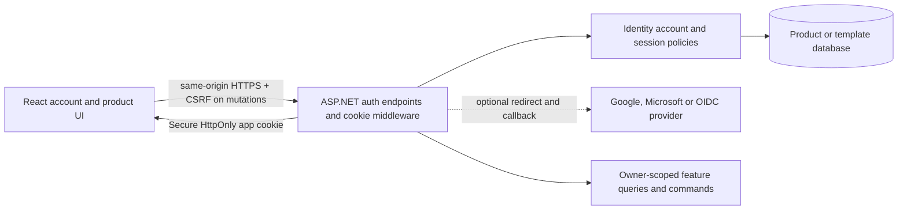

# React authentication foundation: investigation and recommendation

Status: investigated on 2026-10-15; the owner selected **ASP.NET Core Identity + app cookies**, with separate accounts for each cloned product. Credential policy and the detailed production scope below remain recommendations. This selection does not authorize authentication implementation and is not a completed security audit. No authentication code, dependency, provider registration, email, infrastructure or deployment was changed.

The immediate consumer is [CarbonCalculator](CarbonCalculatorDelivery.md): private saved projects, invoice attachments and access across devices make authenticated server ownership a better long-term fit than device-only persistence. The template should provide reusable authentication; the product should own project/document authorization and retention.

## 1. Recommendation

The owner selected the recommended **ASP.NET Core Identity backend with app cookies**. Extend it with same-origin cookie sessions, a typed authentication API and a React account UI. Keep Blazor as another supported consumer of the shared backend while this repository is a template. Offer optional Google/Microsoft or standards-based OIDC sign-in through the backend. Retain public-only React behavior as an explicit supported mode.

This is an architectural recommendation from the inspected template and the requirements, not a claim that external-provider accounts or commercial hosted services have been configured. It requires no additional identity-server process, Node production server or paid authentication dependency. Email delivery and operational capacity still need an actual free/existing solution.

For CarbonCalculator, prefer authenticated server-owned projects/documents after this foundation is available. That would replace the earlier recommended browser-only ownership design. The owner has asked for alternatives, not selected the final authentication/credential policy yet; D02 remains open until that decision is recorded.

### 1.1 Long-term production recommendation after the account-isolation decision

The owner explicitly wants **separate accounts across cloned products**, not a shared cross-product account or SSO. Keep this as a settled requirement. Reusing template code does not mean sharing a running identity service or account database.

For this requirement and the existing ASP.NET/React, self-hosted, initially free-only architecture, **ASP.NET Core Identity is the recommended long-term production foundation**. It is not a temporary system to replace merely because the product acquires paying users. The framework owns password hashing, credential verification and token primitives; the application must still implement and operate the complete supported account lifecycle. Browser cookies remain Microsoft's recommended mechanism for this browser topology. [Identity and SPA guidance](https://learn.microsoft.com/en-us/aspnet/core/security/authentication/identity-api-authorization?view=aspnetcore-10.0).

Recommended initial credential policy, pending owner selection:

1. Start with **verified email/password and working reset/recovery**, so users do not need a particular Google/Microsoft account. Support password managers and avoid arbitrary periodic password changes; require a change on evidence of compromise. Define the actual password, lockout and throttling policies in A01 before implementation. These usability/policy recommendations follow [NIST's current authentication guidance](https://pages.nist.gov/800-63-4/sp800-63b.html), without claiming formal NIST compliance for this app.
2. Provide **optional authenticator-app TOTP with recovery codes** as the first strong-sign-in slice; require strong authentication for any privileged support/administration capability before exposing it. Do not create an admin interface just for authentication. Password reset must not silently bypass enabled MFA.
3. Add **passkeys as an additional primary sign-in method**, with a usable backup/recovery method and credential management, in the next bounded slice. This is valuable on construction-site phones, but it is not required to turn the first account release into a passkey-only product. .NET 10 provides the underlying Identity support; the React ceremony still needs implementation. [Passkey support and recovery](https://learn.microsoft.com/en-us/aspnet/core/security/authentication/passkeys/?view=aspnetcore-10.0).
4. Treat Google/Microsoft as optional convenience methods after a real user need is established. They remain compatible with separate product accounts: each app maps the provider identity to its own local user and grants no access to sibling products. Do not build every provider in the first release.

The per-product production boundary must include:

- **Account and data isolation:** an independently migrated user store and stable app-local user IDs, with separate database credentials/access where applicable. An email address can register independently in several products without linking their accounts, deletion or permissions. Do not copy real template users, password hashes or external login mappings into a new clone.
- **Session and credential isolation:** stable app-specific cookie names, host-only cookies, Data Protection application identity and protected key storage. Keep these identities stable across updates and replicas of the same app. Never copy another product's key ring; the same shared deployment host does not justify shared cookies. Configure passkey RP/origin scope per product rather than at a common parent domain.
- **Provider isolation:** separate product/provider client registrations and callback configuration when external login is enabled. Users may already have a session at Google/Microsoft, but that does not sign them into another product automatically. Their password reset, export, deletion and product authorization remain app-local.
- **Operational ownership:** durable account/project/file storage, protected backups with restore evidence, monitored email failures/limits, security updates and a documented recovery procedure. Free dependencies remove a licensing bill, not these operating responsibilities. Rate-limit email requests and use bounded delivery retry; do not silently pretend a reset email was delivered.
- **User-visible completion:** real registration/confirmation/recovery and session-expiry behavior, accessible React account views, TOTP recovery when enabled, account export/deletion, and proof that two users cannot read or mutate each other's projects or invoices. Section 7 is the full readiness contract; no production claim rests on a login screen alone.

Build and verify A01–A03 in the template first, with the local-account policy selected; schedule A05's TOTP/recovery scope before any privileged operations and optional passkeys as a distinct completion gate. A04 is optional, not a prerequisite for accounts. Then clone the verified foundation and implement CarbonCalculator ownership in C-A01. Preserve the accepted Dashboard/delivery flow; account settings belong in a small account menu rather than another product navigation section.

Managed identity remains a serious alternative when reducing credential operations or buying enterprise identity capabilities becomes more valuable than avoiding recurring dependencies. It still needs app authorization, safe session integration, retention and account recovery configuration. For example, Auth0 documents an external email provider for its email workflows and its built-in provider for development. Hosted authentication does not automatically solve production email delivery. [Auth0 email setup](https://auth0.com/docs/customize/email).

Reassess a managed OIDC provider for an actual requirement such as contracted identity support or enterprise federation. A stable internal user ID and contained provider adapters reduce migration impact, but credential/passkey migration is not automatically portable and must be assessed before a switch. Central Keycloak/authentik/OpenIddict is outside the selected baseline because shared cross-product identity is not required. These are recommendations tailored to this template and product, not claims that every production app should operate its own credentials.

## 2. Three separate decisions

1. **Account identity:** who the user is and how credentials are checked. Local Identity, an external sign-in provider and a central identity service are alternatives here.
2. **Browser session:** how the browser calls this app. A secure app cookie is the recommended mechanism for the same-origin ASP.NET/React host, independent of where sign-in happened.
3. **Data authorization:** which project/document that account may access. This is a product query/command policy, not something an identity provider supplies automatically.

Do not frame cookies and Google/Keycloak/Auth0 as mutually exclusive choices. An external provider can authenticate the person while ASP.NET issues the app's cookie. Microsoft recommends browser cookies and documents backend OIDC/BFF flows; the same-origin template already supplies the relevant backend. [Identity for SPAs](https://learn.microsoft.com/en-us/aspnet/core/security/authentication/identity-api-authorization?view=aspnetcore-10.0), [backend OIDC](https://learn.microsoft.com/aspnet/core/security/authentication/configure-oidc-web-authentication).

## 3. What the repository actually has

These are source observations, not newly executed authentication tests.

| Observed component | Evidence | Consequence |
| --- | --- | --- |
| Shared Identity backend | [LoginFeatureExtensions.cs](../BlazorAutoApp/Features/Login/Account/LoginFeatureExtensions.cs) configures Identity application/external cookies, EF stores, roles, SignInManager and token providers | Reuse framework account logic; do not replace it with a custom password/JWT system |
| Persisted passkeys | [AppDbContext.cs](../BlazorAutoApp/Infrastructure/Persistence/AppDbContext.cs) includes Identity's passkey entity; Blazor has registration/sign-in/management flows | Useful framework capability exists, but this does not provide a React ceremony |
| Blazor-only account composition | [BlazorIdentityServiceCollectionExtensions.cs](../BlazorAutoApp/Features/Login/Account/BlazorIdentityServiceCollectionExtensions.cs) registers account UI and optional Google provider | Google registration is currently coupled to frontend composition and must move to shared backend composition |
| Public-only React | [FrontendProfiles.md](../docs/FrontendProfiles.md) explicitly defines public-only behavior; [React composition](../BlazorAutoApp/Frontend/FrontendComposition.React.cs) maps no account endpoints | React authentication is an intentional new supported capability, not a missing login button |
| Credential-free React API transport | [client.ts](../BlazorAutoApp.React/app/api/client.ts) uses `credentials: "omit"` | Add a separate credentialed same-origin private client; preserve intentionally public calls |
| Reserved account/callback paths | [ReactFrontendHosting.cs](../BlazorAutoApp/Frontend/ReactFrontendHosting.cs) excludes `/account`, `/api` and provider callbacks from SPA fallback | Deliberately map auth endpoints/React routes; never turn unknown callbacks or API errors into HTML |
| Incomplete production email lifecycle | [IdentityNoOpEmailSender.cs](../BlazorAutoApp/Features/Login/Account/IdentityNoOpEmailSender.cs) completes without sending; confirmed accounts are not required in Identity configuration | Existing forgot-password/confirmation screens do not prove actual recovery/email ownership |
| Password failure lockout disabled in current UI | [Login.razor](../BlazorAutoApp/Features/Login/Account/Pages/Login.razor) passes `lockoutOnFailure: false` | Choose and enforce production abuse/lockout behavior before enabling local passwords publicly |
| Logout bypasses antiforgery | [Identity endpoint extensions](../BlazorAutoApp/Features/Login/Account/IdentityComponentsEndpointRouteBuilderExtensions.cs) explicitly disables it on logout | Replace with a deliberate validated mutation contract; no exploit was tested in this investigation |
| Auth limiter identifies the old route family | [AppRateLimiting.cs](../BlazorAutoApp/Infrastructure/Hosting/AppRateLimiting.cs) recognizes account writes under `/Account` | New `/api/auth` operations must receive the auth policy explicitly |
| Useful owner scoping | [BooksServerService.cs](../BlazorAutoApp/Features/Books/Services/BooksServerService.cs) filters by current user and scopes cache keys | Retain this pattern for project/document queries; endpoint authorization alone is insufficient |
| Existing Data Protection persistence | [AppCachingExtensions.cs](../BlazorAutoApp/Infrastructure/Hosting/AppCachingExtensions.cs) persists keys to Redis or filesystem | Keep app isolation/key persistence through restart/restore; Redis is not intrinsically required for single-node cookies |
| Existing browser coverage is Blazor-specific | [IdentityE2ETests.cs](../BlazorAutoApp.Test/E2E/Features/Login/IdentityE2ETests.cs) derives from a Blazor test base | It is a useful starting inventory, not evidence that React login/passkeys work |
| Development proxy is API-only | [vite.config.ts](../BlazorAutoApp.React/vite.config.ts) proxies `/api` | Development callback/cookie/passkey origins need a deliberate end-to-end policy |

## 4. Alternatives that fit this template

| Option | Fits the existing architecture | Free-operation implications | Main tradeoff | Recommendation |
| --- | --- | --- | --- | --- |
| **A. Local ASP.NET Core Identity + cookies** | Reuses current EF/user/SignInManager infrastructure; frontend stays React/Blazor and runtime stays ASP.NET | No per-user auth vendor bill; own database/key/recovery operations; real email delivery needed for email/password recovery | The app operates account security and recovery | **Default reusable foundation** |
| **B. External sign-in + local app accounts/cookies** | ASP.NET handles Google/Microsoft/OIDC redirects, maps provider identity to stable local user ID and issues app cookie | No separate auth SaaS is required for direct provider integration; provider registration/terms and availability still apply | Users depend on a supported external account; safe linking/recovery still needs design | **Good optional sign-in method on A**; external-only is a valid product policy |
| **C. Self-hosted central OIDC service** | Each app becomes an OIDC client with its own app cookie and database ownership | Open-source choices exist; extra services, DB, updates, TLS, key rotation, backups and node capacity | Central SSO is useful across many apps but expands operational scope | Add when shared SSO/central administration is an actual requirement |
| **D. Managed identity service** | Standards-based hosted OIDC can terminate at ASP.NET; SDK/JWT-based vendors need a deliberate server integration | Current free tiers exist but caps, email/custom-domain rules and paid feature boundaries apply | Less credential infrastructure to operate, more external dependency and exit/cost planning | Reasonable optional provider, not mandatory template infrastructure |

These are not four systems to implement. Build A's shared account/session/authorization boundary, then enable the credential/provider methods actually selected. B can reuse A's local user store without requiring users to create a local password.

### A: native Identity, credential choices and endpoint choices

Email/password with confirmation, recovery and optional TOTP/recovery codes offers broad compatibility. Passkeys can be an additional primary sign-in method. Passkey-only signup is possible but must have a real enrollment/recovery design before release; simply removing the password UI can strand users.

.NET 10 Identity supports passkeys; the template's existing Blazor implementation demonstrates the backend methods. Microsoft documents browser/HTTPS/origin, recovery and primary-factor limitations. React needs its own browser ceremony and endpoint adapter, without implementing cryptographic verification itself. [Passkey documentation](https://learn.microsoft.com/en-us/aspnet/core/security/authentication/passkeys/?view=aspnetcore-10.0).

`MapIdentityApi<TUser>` is a useful reference or starter for common account JSON operations. It is not a complete production React account feature. Its optional bearer tokens are proprietary Identity tokens, not standard JWTs or a full OIDC server. Also, passkey endpoint additions are tracked for .NET 11; do not mistake the repository's development branch for the template's pinned .NET 10 behavior. [Identity API contract](https://learn.microsoft.com/en-us/aspnet/core/security/authentication/identity-api-authorization?view=aspnetcore-10.0), [passkey endpoint issue](https://github.com/dotnet/aspnetcore/issues/62998).

For this template, prefer thin feature endpoints using UserManager/SignInManager and generated contracts, with explicit enabled methods, antiforgery, rate policies and safe ProblemDetails. Avoid mapping an unused bearer-login path merely because a starter offers it. Do not implement hashing/token formats/recovery verification from scratch.

UI alternatives are React-native account views or a small common ASP.NET account-page surface. Razor Pages are different from Blazor, so server-rendered login pages would not require a Blazor runtime in a React product. However, they introduce another maintained UI surface. React-native views over shared backend operations fit the current product direction best; existing Blazor views should call the same backend policies rather than duplicate account rules.

### B: direct Google/Microsoft sign-in

The existing Google handler can move into shared authentication composition. Provider callback handling stays in ASP.NET; React begins navigation and receives the resulting app session. Keep provider tokens off the browser and avoid storing them unless another real feature requires them. [Google setup](https://learn.microsoft.com/aspnet/core/security/authentication/social/google-logins), [external claim/token handling](https://learn.microsoft.com/en-us/aspnet/core/security/authentication/social/additional-claims?view=aspnetcore-10.0).

Prefer full-page provider redirects over popup flows so existing COOP/CSP protections can remain deliberate. Configure callback handling and development proxy origins explicitly; a successful provider screen is not proof that its callback/session works through the actual frontend host.

Microsoft personal accounts and work/school Entra tenants are distinct audience/tenant choices. Validate the configured issuer/tenant/audience and account type; “Microsoft login” must not accidentally become one company's tenant-only login. Adding a provider button does not define business membership or project permissions.

Link accounts using the provider's stable identifier and issuer/provider namespace, then map to a local immutable app user ID. Never merge two accounts merely because emails match. Linking requires an authenticated current session and fresh provider proof; unlinking the last usable recovery/sign-in method must be refused. Provider email claims require a documented trust policy if used for app email confirmation.

External-only sign-in reduces the app's password/reset-email scope but transfers recovery dependence to the provider. It does not remove local user records, ownership checks, session lifecycle, export/deletion or account-linking responsibilities. Users without the selected provider need an explicit supported alternative or a clear product limitation.

### C: central SSO choices (outside the selected account-isolation baseline)

- **Keycloak:** mature standalone identity-server option. Production configuration includes database, host/TLS and capacity operations; its container guide recommends a 2 GB memory limit for smaller production-ready deployments. This is an additional shared service, not an app library. [Production guide](https://www.keycloak.org/server/configuration-production), [container requirements](https://www.keycloak.org/server/containers).
- **authentik:** another credible self-hosted central option. Its supported Compose architecture includes server, worker and PostgreSQL. Use its supported deployment/update runbooks rather than building an improvised lightweight stack. [Installation](https://docs.goauthentik.io/install-config/install/docker-compose/), [first steps](https://docs.goauthentik.io/install-config/first-steps/).
- **OpenIddict:** closest to the .NET ecosystem when a custom OIDC server is genuinely wanted. It is Apache-2.0 licensed, but supplies protocol infrastructure, not a turnkey complete identity product. The team still owns account UI, administration, issuer/key operations and recovery. [Introduction](https://documentation.openiddict.com/introduction), [license](https://openiddict.com/).

Do not add a central issuer only to make one same-origin browser app sign in. If several products need the same account/SSO, prefer a supported issuer and standard app clients. Each app still owns its own session/permissions; sharing parent-domain cookies, Data Protection keys or user tables among independent apps is not the default SSO design.

### D: managed free-tier examples

Checked on 2026-10-15; recheck before adoption. These figures are not a promise of indefinitely free production operation.

| Provider | Current published entry allowance | Fit/caveat |
| --- | --- | --- |
| [Auth0](https://auth0.com/pricing) | Free tier lists 25,000 monthly active users | Strong hosted-OIDC candidate. Custom-domain inclusion requires credit-card verification; the comparison marks cross-app SSO outside Free. Review actual plan limits before choosing it for shared login |
| [Supabase Auth](https://supabase.com/pricing) | Free tier lists 50,000 monthly active users | Adds a hosted platform/auth dependency; free projects pause after one week of inactivity. Does not require moving the app's EF data, but that integration/ownership boundary must be designed |
| [Clerk](https://clerk.com/pricing) | Free tier lists 50,000 monthly retained users | Convenient React-oriented offering, but retained-user billing differs from MAU. Production feature/organization limits and ASP.NET server validation must be reviewed |

I would not select a service solely because its free headline is larger. Compare identity export, custom-domain requirements, email limits, recovery/MFA, availability, privacy and what happens at the cap. No automatic paid upgrade/card-required dependency is authorized by this investigation.

Duende's BFF/IdentityServer products have production licensing conditions; do not assume “BFF pattern” requires a Duende package or that a development/trial license is an unconditional free commercial baseline. The ASP.NET cookie/OIDC architecture can use built-in middleware. [Duende licensing](https://docs.duendesoftware.com/general/licensing/).

## 5. Recommended browser/session architecture

The cookie is host-only and app-specific, Secure/HttpOnly, with deliberate SameSite behavior. Cross-origin redirect/correlation cookies use the provider middleware's appropriate policy; do not apply blanket SameSite Strict that breaks callbacks. Do not store access/refresh/session bearer tokens in localStorage. Same-origin private fetch uses credentials plus the antiforgery header; public fetch remains intentionally credential-free.

An ASP.NET host that authenticates its own same-origin API does not need a new proxy process or gateway merely to call this architecture BFF. Bearer/OIDC access tokens become useful for separate API/native clients; design that boundary when such a consumer exists.

## 6. Authentication scope versus product scope

| Reusable template responsibility | CarbonCalculator responsibility |
| --- | --- |
| Account lifecycle, local stable user ID and enabled sign-in methods | Project/receipt/document ownership and any future project memberships |
| Current-user/session DTOs, cookie/CSRF transport and 401/403 behavior | Saved project APIs, concurrency and active-project access |
| Confirm/reset/change credential, lockout, TOTP/recovery and passkey ceremonies when enabled | Private invoice storage, file quotas, retention and deletion |
| Provider challenge/callback/linking and safe return URLs | Mapping existing guest/local drafts into the signed-in user's project after confirmation |
| Data Protection/session recovery and provider configuration | Immutable calculation reports, source provenance and account deletion effects |
| Public-mode compatibility and real auth acceptance profile | Product role/membership matrix and cross-owner/IDOR acceptance |

Keep authentication frontend-independent. Preserve current public React defaults unless a clone enables the new supported capability. Do not create ReactPublic/ReactAuthenticated source builds and duplicate deployment targets just to choose auth behavior; define an explicit runtime feature/acceptance contract and prove disabled mode denies account/private operations correctly. The actual setting/manifest schema belongs to the implementation design, not a speculative variable copied into deployment now.

Identity EF stores do not force a managed database. The template can retain its PostgreSQL infrastructure; a single-node CarbonCalculator can use a reviewed SQLite Identity schema/migration. Do not remove Identity while removing Blazor. Account data, business ownership and provider adapters should not be coupled to the UI framework.

## 7. Required production behavior before claiming authentication is ready

1. **Account lifecycle:** register, verify email if local email identity is used, login, logout, forgot/reset password, change email/password, current account, export and delete. Delete/credential-change actions need recent authentication. Disable unsupported methods honestly.
2. **Recovery:** real email delivery/confirmation/reset proof, purpose-bound short-lived tokens, generic non-enumerating responses and rate limits. A no-op sender is allowed only in explicitly non-production/test mode. Authentication must not appear healthy with required recovery silently disabled.
3. **Cookie/CSRF:** apply explicit validation to cookie-authenticated mutations including login/logout/linking; safe read-only bootstrap issues the request token. External callback state/correlation uses the authentication handler, not an arbitrary exemption for account endpoints.
4. **Abuse:** route-independent auth rate policies, failed-password lockout policy, bounded resend/reset/passkey operations and account-enumeration review. Existing IP rate limiting alone does not replace credential abuse policy.
5. **Session lifecycle:** choose idle/absolute/remember-me policies, security-stamp revalidation and sign-out/revocation behavior. State its actual revocation delay; clearing one browser cookie is not logout everywhere. Password reset/account disable must invalidate affected sessions according to that contract.
6. **React isolation:** session query/private query caches are scoped to the signed-in user and cleared on logout/account change. Handle 401 expiry without losing an unsaved edit or retrying mutations indefinitely. No old user's private records remain visible after another user signs in.
7. **Authorization:** require the stable local user ID and owner/membership filter in the database query/command, including downloads, exports and reports. Unpredictable IDs and hidden buttons are not access control. Test two actual users.
8. **External identity:** validate provider configuration, issuer/audience/correlation and local return URL; never auto-link by email or accept a browser-posted external user ID as proof. Do not retain unused provider tokens.
9. **Passkeys when enabled:** bounded challenges/credentials, protected enrollment, origin/RP policy and lost-device recovery. Use the Identity methods and browser APIs. Relying-party origin configuration must be reviewed for actual production/dev hosts; no parent-domain widening to share credentials accidentally.
10. **Operations:** persist app-isolated Data Protection keys and account database across updates; restore them together, isolate cookie names across apps/localhost ports, validate forwarded hosts and keep private responses no-store at the app/edge. Do not copy another product's keys/cookies.
11. **Sensitive flows:** suppress passwords/cookies/email-link tokens/PII in logs, traces, URLs emitted by the app and error responses. Framework confirmation/reset links necessarily carry one-time secrets; redact those query paths and remove consumed tokens from browser navigation. Do not leak them through telemetry or third-party resources.
12. **Acceptance:** actual React register/confirm/login/private operation/logout/expiry/reset and cross-owner browser/API paths, plus Blazor regression and disabled public mode. A login form screenshot or mocked principal test alone is insufficient. These checks are proposed, not run in this investigation.

## 8. Email and cost realism

Reuse an existing protected SMTP service if suitable. Otherwise a bounded free transactional provider is possible; [Resend's current pricing](https://resend.com/pricing) lists 3,000/month and 100/day. Recheck the actual selected account/terms before configuration. Domain/sender verification, delivery limits and abuse controls are real work. No new paid plan or SMS authentication is required by the recommendation.

External-only login can use the provider's recovery instead, but requires an explicit product decision and safe alternative/linking policy. Magic links make every login depend on email delivery and token consumption; they are an optional credential policy, not a shortcut around recovery/spam/forwarded-link/session concerns. Passkey-only similarly needs a backup method.

The agent can prepare code/configuration/DNS records and use existing protected credentials during authorized execution. Only unavailable provider-console consent, domain proof/login and genuine inbox/device interaction need human involvement. No provider account, email credential or hardware action is assumed missing now.

## 9. Implementation sequence if this direction is selected

| Slice | Complete visible outcome | Important gate |
| --- | --- | --- |
| A01 — Contract and composition | Shared auth feature, explicit public/enabled mode, typed session/error/CSRF contracts, mapped route/callback policy | Public React remains public-only when disabled; Blazor works; OpenAPI generation needs no live DB/email/provider |
| A02 — First credentialed React slice | Secure session, login/logout/current-user UI and one existing owner-scoped Books operation | Real two-user separation, CSRF, 401/403 and cache isolation |
| A03 — Account lifecycle | Register/confirm, real email adapter, reset/change credential, deletion/export and abuse policies | Actual delivery/recovery proof with controlled authorized accounts |
| A04 — External sign-in | Shared optional Google/OIDC composition, local account mapping, callback and safe linking | No email-only linking, unsafe redirects or browser-held provider secrets |
| A05 — Strong sign-in and sessions | TOTP/recovery and/or passkeys according to selected scope, bounded revocation contract | React ceremonies/recovery, correct RP/origin, no lockout-by-unlink |
| A06 — Deployment and clone contract | Updated profile/acceptance/docs/audit, key/email/provider readiness, public-mode and Blazor regression | Full local gate, exact-head/main CI, restore evidence, all retained template targets and documented clone retention |
| C-A01 — CarbonCalculator adoption | Server-owned projects/receipts/documents with user-scoped endpoints and local draft migration | Product two-user/IDOR tests and retained approved UI |

Each slice includes backend, generated client, frontend, failures, persistence and relevant evidence. Implementation code requires PRs, local gates and exact-head/main CI under AGENTS.md. This investigation uses the Markdown-only exception and does not execute those code gates.

Template support remains portable across its retained deployment targets: replicas of the same app need compatible shared Data Protection state, while independent applications keep distinct stable application/cookie identities. Do not introduce LocalSingleNode-only assumptions into the shared template authentication kernel. CarbonCalculator narrows its own deployment targets later through its separate cleanup plan.

The production recommendation is A01–A03 for a self-contained local-account baseline, followed by the scoped strong-sign-in work in section 1.1. If the owner instead selects external-only, replace local-password portions with provider lifecycle/recovery. Do not build all credential/provider alternatives. Passkeys/TOTP/external providers need accurate capability flags until their complete slices pass.

## 10. CarbonCalculator changes after account ownership is approved

- Replace proposed browser-only project persistence with authenticated server project/receipt APIs. IndexedDB can remain a draft/cache aid, not the only saved copy.
- Tie files and reports to project/user ownership; separate any future guest capability mode. Normal account documents must not inherit the earlier automatic 24-hour anonymous expiry by accident. Specify user-visible retention and deletion before implementing it.
- Compute Dashboard aggregates from server-owned current assessments. The proposed HMAC client-contribution round trip is unnecessary for ordinary authenticated project queries; retain signed/imported snapshots only where an actual trust boundary needs them.
- Keep immutable calculation/source snapshots and the approved direct Material/Transport/Documents navigation. A login system does not require adding a busy sidebar or review workflow.
- Use a stable owner ID from the authenticated principal. Company/supplier names in invoices are not tenant membership or account identity.
- Begin with private user-owned projects unless team sharing is explicitly promoted. Future organizations need memberships/roles/invitations and a separate product authorization slice; signing in is not team support.
- Update D02, P04/P08A/P11B/P12/P12A/P12B and Acceptance.md together. Keep Identity during cleanup and reconsider only obsolete sample storage. Do not maintain two conflicting authoritative persistence models.

## 11. Decision to retain

**Selected architecture:** ASP.NET Core Identity + app cookies. Recommended delivery: template-first shared backend and React account UI, with optional external sign-in and phased passkeys. Use server-owned private CarbonCalculator projects once that foundation and its account policy are selected.

**Settled owner requirement:** separate accounts across cloned products; no shared cross-product identity or SSO. Each clone owns its user store, sessions, keys, product authorization and account lifecycle. Optional external login does not change that ownership boundary.

**Production recommendation:** verified local email/password with real recovery, optional TOTP/recovery and phased passkeys, secure app cookies, and server-owned private projects/documents. Managed OIDC remains an alternative for a concrete operational/business requirement; a central identity service is outside the selected baseline.

Still to select before implementation: the recommended local-account credential policy versus external-only sign-in, and explicit approval of authenticated CarbonCalculator ownership. Identity + app cookies and separate product accounts are already answered and must not be asked again. This document prepares the remaining choice without implementing or registering any alternative.
