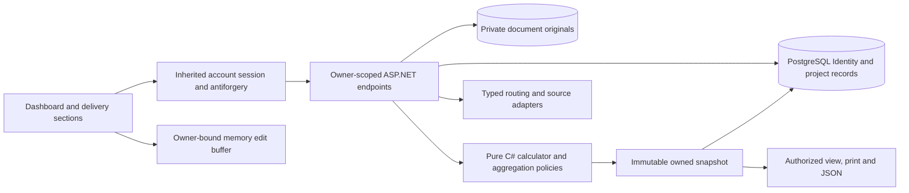

# CarbonCalculator feature specification

Status: implementation contract, 2026-10-17. The owner approved the current direct-navigation mockup. No product feature is implemented by these planning documents.

Read with [the delivery plan](../../CarbonCalculatorDelivery.md), [implementation packets](ImplementationPackets.md) and [acceptance traceability](Acceptance.md). This document owns feature behavior and state rules; the delivery plan owns scope, delivery authority and deployment. Tests below are requirements for future implementation, not results.

## 1. Product decisions and precise boundaries

### Approved

- Construction-site users record materials arriving at their project. Supplier billing address, production location, dispatch location and project destination have distinct roles.
- Fieldwork palette and the current Dashboard/Material/Transport/Documents composition are approved. Do not hold implementation for another color or layout choice.
- Dashboard has a compact scoped estimate and searchable material-delivery list. Add delivery is beside that list's title. There is no duplicate To review card or approval workflow.
- Material, Transport and Documents are direct links on each record. They select sections within one editable delivery workspace. Save delivery returns to Dashboard. Export report is contextual output.
- About holds general explanations. Calculation/source inspection remains available for specific values. Future OCR is separate from attaching a document.

### Selected D02: accounts and private PostgreSQL projects

On 2026-10-17 the owner selected verified email/password accounts with private server-saved projects across devices and confirmed PostgreSQL. A project belongs to one Identity user through `Projects.OwnerUserId`; deliveries, reports and document metadata belong to that owned graph. Reuse completed template accounts; no SSO, organizations, sharing or React MFA/passkeys in v1.

[AccountsAndOwnership.md](AccountsAndOwnership.md) is authoritative for account flows, access matrix, schema, memory draft isolation, concurrency, retention, deletion/export, mail and recovery. P08B adapts accounts before P08A completes persistence. Saved data lives on the server; IndexedDB/device-local projects and anonymous report/receipt tokens are superseded. Browser drafts are unsaved memory state, not a durable fallback. Templates have accounts disabled by default; this product must enable and validate them. Public launch level remains separate.

### v1 modeling scope

One saved material-delivery record represents one homogeneous material quantity for one receipt at one project. It is not a vehicle, whole invoice or necessarily the entire physical arrival. Several records may share invoice/reference/supplier information. An invoice can cover several arrival dates. Do not reject duplicate invoice references globally or infer that two records require two trucks.

The internal record has `physicalDeliveryReference` and `documentLineReference` when supplied. This permits later grouping without rewriting calculations. Multi-material line editing and shared-vehicle/fuel allocation are explicit future scope; the current approved one-material screen remains the v1 contract. Warn about apparent duplicate records, but permit an intentional additional receipt after confirmation. Do not deduplicate by supplier name or invoice reference alone.

Accounts and cross-device access to the same user’s server-saved projects are included. Team permissions, OCR, automatic supplier discovery, live carrier history, commercial price comparison, building compliance decisions, A5/site-energy calculation and automatic regulatory filing are excluded from v1. Existing mandatory routing, ferry and second-provider commitments remain required.

## 2. Feature inventory and delivery ownership

| ID | User outcome | Implementation packet | Essential completion evidence |
| --- | --- | --- | --- |
| F01 | Create/select a project and keep its destination | P08A | Reopen project and change site without moving another project's data |
| F02 | Understand recorded transport from Dashboard | P11B | Compatible totals, coverage and filters agree with saved records |
| F03 | Add, edit, save and delete a material delivery | P08A, P11, P11B | Partial saves, stable identity, unsaved edits and duplicate warning |
| F04 | Enter quantity with an honest conversion | P11, P13 | Original quantity and sourced conversions, no unknown-as-zero |
| F05 | Select suitable material/EPD evidence | P09, P11, P13 | Exact/proxy/metadata-only decisions through actual contracts |
| F06 | Use the standard-material transport method | P11A | Version/category/basis checks and independent source-backed arithmetic |
| F07 | Find and confirm places | P09–P10 | Real candidates, selected precision and stale text/point handling |
| F08 | Explore road routes without an EPD | P09–P10 | New locations produce actual HGV routes or real errors |
| F09 | Describe route knowledge and vehicle/load limits | P11, P14 | Constraints preserved; feasible gross/volume allocations |
| F10 | Compare ferry corridors and select a route | P15–P16 | Directional gate evidence, deterministic ranking and saved override |
| F11 | Represent a warehouse and lifecycle boundary | P14 | Two real movements, preserved gaps and no duplicate production |
| F12 | Attach, retrieve and remove supporting documents | P12A | Scoped ownership, persistence/expiry and safe file handling |
| F13 | Inspect the source and substituted formula | P11B, P16 | The UI and report use the same calculation nodes |
| F14 | Export, reopen and compare immutable reports | P12, P12B | No provider calls on read; old values survive source changes |
| F15 | Recover from unavailable/limited services | P09–P10, P18 | Useful partial state, bounded spend and explicit offline sample |
| F16 | Add reviewed sources without new screen math | P13, P17 | Staged importer, field review and second provider through shared UI |
| F17 | Use keyboard, mobile, About and Privacy | D01, P08, P18 | Approved flow works with focus, reflow, errors and print |
| F18 | Register, recover/sign in and manage private account-owned work | P08B, P18, P21 | Real account flows, two-user denial, export/deletion and recovery; AC41–AC52 |

## 3. Shared data contracts

Use C# request/response contracts as authority and generate the TypeScript client. UI draft types may include raw strings and dirty markers. They must not masquerade as validated domain values. IDs below are opaque, application-generated IDs; names/filenames are never keys or access grants. AccountsAndOwnership.md defines the full relational ownership graph.

| Record | Required fields and invariants |
| --- | --- |
| `Project` | `id`, schema version, name, optional project/reference note, destination `PlaceSelection`, optional regulatory-edition reference, created/updated UTC, server revision and required immutable `OwnerUserId` FK derived from the session. No default real address or compliance status |
| `DeliveryRecord` | `id`, `projectId`, server revision, optional physical-delivery/document-line references, received local calendar date, material selection, original quantity, supplier fields, dispatch knowledge, chosen assessment basis, source/evidence refs, attachments and current saved assessment refs |
| `QuantityInput` | Original text/value/unit, quantity basis `received` or `incorporated`, origin `user`/`document`/`derived`/`assumed`, optional source reference. Missing is a tagged state, not zero. Preserve separate received/incorporated quantities if both are supplied |
| `Conversion` | From/to unit, exact value or explicitly sourced range, source revision, original source notation, user assumption/consent if applicable. Never overwrite the original quantity |
| `PlaceSelection` | Raw search label, selected normalized label, coordinates when present, precision, role, country, user confirmation and source/time. Editing text invalidates the previous selection |
| `SupplierFact` | Optional name, invoice/company address, original document reference and evidence. A legal entity is not a geographic transport origin |
| `DispatchKnowledge` | `unknown`, `invoice_address_only`, `user_declared_location`, `document_stated_location`, `explicit_scenario_assumption`; selected place and independent evidence status. Document attachment alone cannot promote it |
| `AssessmentSelection` | Method ID/revision, standard category or route/factor choices, indicator/module, quantity basis, selected evidence set, source edition and applicability status |
| `AssessmentStatus` | `not_calculated`, `input_needed`, `current`, `stale`, `unavailable`; independent `coverage` and `dataMode`. A current result can still be partial or illustrative |
| `CalculationNode` | Stable node ID, input refs, operation/formula, exact authoritative output, display unit, source refs, warning codes and count/exclude decision |
| `SavedAssessment` | Immutable snapshot ID/hash, method/data/schema revisions, input fingerprint, route-set refs, source snapshots, quantity normalization, results, independent evidence dimensions, coverage and recorded time |
| `Attachment` | Server ID, owner project/record refs, original display name, validated type/bytes/hash, lifecycle state, timestamps and evidence roles. Private originals persist until deletion; no public URL in exports |
| `UploadStaging` | Owner/record-bound temporary upload state, byte reservation, expiry and recoverable promotion metadata; not an anonymous receipt container |

Dates received are local calendar dates, not UTC midnight timestamps. Store calculation/provider events in UTC and display the local timezone explicitly when relevant. Text limits: project 120 characters, supplier 200, reference 100, address/search text 500 and notes 2,000; validate Unicode safely and render as text. Configure finite quantity/geometry limits with field errors; never silently truncate significant user values.

### API envelopes and initial product bounds

| Operation | Required request fields | Required response fields |
| --- | --- | --- |
| Place search | Search text, optional country hint, request ID | Candidate ID/label/point/precision/country/source/time, or typed empty/unavailable state |
| Find routes | Confirmed from/to/via, data mode, knowledge, ferry policy, vehicle/load profile, input fingerprint | Owner-bound route-set ID/envelope, expiry/fingerprint, complete/partial/excluded candidates, per-leg provenance, recommendation and warnings |
| Create/recalculate | Record/lot identity, quantity and conversion references, EPD consent/version if selected, method/category/factor revisions, authorized selected route set and report-context inputs | Immutable snapshot, current/partial/input-needed status, exact results/nodes, independent evidence/coverage, owner-bound immutable report ID, fingerprints and temporary/saved lifecycle |
| Aggregate | Owned project ID/revision and current record refs; at most 500 saved records | Method-group totals, material breakdown, included/excluded record IDs and reason counts, aggregation revision/hash; server-authorized saved snapshot sources |
| Upload evidence | Owned project/delivery IDs, antiforgery, scoped idempotency key, streamed file and safe evidence label | Attachment ID, detected type/bytes/hash, availability/expiry and safe metadata; no public URL |
| Read/delete report | Opaque report ID plus current session; antiforgery on deletion | Original snapshot, or deletion outcome; foreign/missing access is indistinguishable; expired sessions return 401 |

Initial configurable bounds: 20 projects per user, 500 delivery records per project, three via points, one optional warehouse and at most three distinct routing restriction profiles per movement. JSON route/calculate bodies are capped at 256 KiB excluding provider geometry held server-side; aggregate/import bodies are capped at 10 MiB and imported records at 500. Bound JSON depth to 32. A large valid project export that exceeds the import limit must fail with guidance before download rather than generating an unrestorable backup. File bounds are separate in F12. The implementation may lower caps after node/browser measurement; it must not silently truncate projects or input.

Set an overall routing operation deadline of 45 seconds and a 20-second upstream-call timeout, honoring cancellation. At most two upstream calls execute concurrently per operation, subject to a stricter global provider cap. For each movement/restriction profile, estimate the budget for one road request plus two approaches for each geographically eligible crossing before starting; count every actual attempt/retry against persisted account limits. No routing key/account-allowance configuration means live unavailable. Quota defaults are derived from the actual free account, not a remembered provider-wide number. Return useful partial/excluded candidates if remaining budget or deadline prevents a full comparison.

Suggested typed ProblemDetails codes include `invalid_quantity`, `conversion_needed`, `place_selection_needed`, `method_category_unsupported`, `route_set_stale`, `source_consent_needed`, `provider_unavailable`, `provider_budget_exhausted`, `upload_too_large`, `storage_limit`, `evidence_expired` and `idempotency_conflict`. Use 409 for stale/idempotency conflicts, 413 for oversized requests and 415 for unsupported upload types, alongside the main plan's 400/422/429/502/503/504 rules. Field validation never discards an editable local record.

### State transitions

```text
New delivery -> editable buffer -> Save delivery -> server-saved record
Saved record -> edit buffer -> Save delivery -> new server revision, same record ID
Edit buffer -> Cancel/leave -> Save, Discard or Stay when dirty
Incomplete inputs -> save allowed -> calculation input-needed, no invented total
Calculation-affecting edit -> prior saved assessment remains historical, current view stale
Calculate -> validate -> server result -> current assessment for matching fingerprint
Newer edit while request runs -> late response retained only as history or discarded, never current
Delete delivery -> explicit confirmation -> record access removed and owned bytes queued for durable cleanup
```

Saving a record is distinct from calculating it. Missing quantity, EPD, dispatch or provider access must not stop a useful partial delivery from being saved. A server validation failure may block a calculation while the draft remains editable/savable. Transport-only and material-only are legitimate outcomes. A report for partial inputs labels itself incomplete and never invents shipment-wide values.

Use conditional server revision checks and owner-scoped transactions. If another tab/device saves the same record, preserve the dirty buffer and offer reload or save as a new record; never silently use last-writer-wins. Bind every request/result to application/user/project/session generation as well as its numeric fingerprint. Provider requests contain only the required route inputs, not project names/supplier notes.

## 4. F01 — Project context

First use shows a compact Create project form: name and site destination. The user can save an unfinished project without a resolved location. Do not seed Harbour Housing or a real address into production. Offer the labelled sample only through an explicit sample action.

The project name in the header opens a small project chooser with create/rename/select actions. This is context selection, not a new primary tab. One project is active at a time; Dashboard, new records and exports take that explicit project ID. Search/filter selections do not cross projects accidentally.

An unresolved destination permits standard-line and production work but blocks site-specific routing. Editing the project destination asks whether existing delivery records should use the new destination; default is to update the project destination for future/current working records and mark affected route assessments stale. Historical reports retain their original site. Never rewrite historical coordinates.

Project deletion gives the project name and record/document counts before confirmation. A cancelled deletion changes nothing. Project export/delete/storage controls belong in this context menu/About privacy area; avoid a Settings tab until it has a real purpose.

Acceptance: empty project, missing/ambiguous destination, two projects with identical references, reopen after browser restart under D02, failed storage save, destination edit, cancelled/completed deletion and no cross-project leakage.

## 5. F02 — Dashboard

### Composition and wording

- Compact estimate card above the delivery list, material breakdown beside it on desktop and below it on mobile.
- Material deliveries heading, record count and Add delivery in the same header.
- Search input and one useful filter. Rows/cards show material, supplier/reference, received quantity, estimate with basis and direct Material/Transport/Documents links. Documents includes its current count.
- Use Dispatch unknown as information, not a review assignment. For a standard method it is not automatically a calculation error. No workflow badge implies human verification.
- No review queue, activity feed, separate materials page, promotional banner, climate score or fabricated savings.

### Aggregation contract

The server receives an owned project ID/revision and loads its saved selected assessments. Validate record/snapshot ownership, current numeric fingerprints, non-overlap and method compatibility in C#. Browser totals, imported snapshots and route IDs alone are not trusted. No HMAC envelope store, separate signing key ring or browser-authoritative aggregation is needed under selected server ownership. Imported reports can be displayed as historical/unverified; explicit recalculation creates a trusted current snapshot. Private aggregate responses use memory-only owner-scoped query state and `no-store`.

Each saved record contributes at most one selected current assessment per compatible method group. Use the key `(methodId, revision, module, indicator, allocationBasis, quantityBasis, dataMode)` plus non-overlapping receipt/movement identity. Do not add alternative routes or a replaced EPD A4. Round only after summing authoritative decimals.

The default headline is the selected standard-material estimate group, with its delivery coverage. Route WTW remains a separate labelled group accessible in the same card when present; do not mix the two. Different method editions/bases appear as separate subtotals until explicitly reconciled. No compatible records means “No estimate yet”, not 0 kg. A genuine complete zero is displayed as zero with its source.

Incomplete, stale, deleted, duplicate-excluded and unverifiable assessments are omitted from current totals with a compact count/link to the relevant existing filter. Do not create another To review card. A retained last-confirmed aggregate can be shown as “Saved estimate · outdated” while offline; never show it as current after inputs change.

The headline and material breakdown cover all saved records in the active project, not the current search or visible page. Say “All project deliveries” when a filter is active. List count and empty-search message reflect the filter. Reusing the same record twice in an aggregate request is rejected. Breakdown sum equals its headline before display rounding; accessible text is available without the colored bar.

Search is case-insensitive over material, supplier and document/line references. Filters include all, dispatch unknown, missing calculation inputs, stale calculations and route estimates. Default order is most recently received, then updated time, then stable ID; undated records sort after dated ones. Use server-side owner/project-scoped filtering and stable pagination with at most 50 records per page. Searching does not call geocoding or routing.

Acceptance: 148 + 45 = 193 for the reviewed sample basis; no amount rather than zero for an empty project; separate WTW/method revisions; deleted/stale/missing/unverified records; search without changing headline; one record edited twice; rounding; project isolation; direct row links and phone layout.

## 6. F03 — Delivery editing and navigation

Add delivery starts empty with the active project destination and the first Material section. It may suggest a material category but must not populate a quantity, supplier, invoice, origin, attachment or result. Creating a new record generates its ID once, before the first save. The server validates/reserves the client request identity under its owner; an ID never authorizes access.

Dashboard links enter `/receipts/:id#material`, `#transport` or `#documents`. An unknown/inaccessible ID shows a private not-found state with Back to dashboard; it does not query another person's records. Direct refresh restores only data authorized by the selected storage contract. Section links use actual navigation semantics, visible selected state and keyboard focus. Browser Back/Forward restores section selection.

Section switching preserves dirty fields without a prompt. Leaving the delivery, changing project or closing the tab warns when applicable; the app never promises the browser will always show a close warning. Save delivery persists an atomic record revision, selected assessment references and attachment metadata, then returns to the same Dashboard filter/scroll position. A failed write keeps the buffer and shows a retry/export option. Do not display Saved until the storage transaction commits.

Calculation failures stay inside Transport or beside the estimate with field-specific guidance; there is no Review page. An accessible result summary announces completion without moving focus away from the user's control. The report opens only when requested and Back to delivery restores the prior section and edit buffer.

When a complete numerical input set has no current result, the estimate panel offers Calculate estimate; after a relevant edit it offers Update estimate. These are contextual states of the existing panel, not a new page. They call the authoritative calculation endpoint using the selected compatible route set if needed. A missing/stale route set directs the user to Search routes before calculating route freight; the standard method never needs that route action. Saving without calculating is allowed and shows Not calculated/Input needed in the existing list. Export report uses an immutable current snapshot or an explicitly incomplete record, never silently recalculates or calls a provider. This replaces the prototype's immediate JavaScript arithmetic without adding a review step.

Delete delivery is a secondary action in the delivery menu, with confirmation. Historical exported copies cannot be retracted. Detach/delete only this record's evidence links; never delete another record's copy because names or hashes match.

Duplicate warning compares project, received date, normalized material/quantity, supplier and document line/reference. Missing fields lower the match confidence. Offer Open existing or Save as separate delivery; no automatic merge and no fabricated probabilistic score. The same invoice with another material/arrival date is normal.

## 7. F04 — Quantity and conversion

Support kg and t directly. Enable m³ only with a relevant density or an explicit sourced/assumed conversion. Enable pieces/m² only when the selected product or user provides piece mass, area mass or compatible dimensions/density. Keep kg, material volume and cargo/packaging volume distinct.

Accept a finite positive amount for a total calculation. Blank means unknown and is a valid saved record. Zero is an intentional no-material case that must be explicitly identified and excluded from delivered mass; negative corrections/returns are not ordinary deliveries. Reject negative, NaN, Infinity, overflow and ambiguous separator input. English decimal parsing must not reinterpret `20,000` or `20.000` silently; provide a format example and validate pasted text before normalization.

Choose the quantity basis independently from its source. Received quantity gives an indicative receipt estimate; using the standard method for reporting requires the applicable incorporated-material basis and eligibility review. Preserve both quantities when supplied, including discrepancies and units, rather than silently replacing received quantity. The official [BR18 Table 10](https://www.bygningsreglementet.dk/bilag/b2/bilag_2/?Layout=ShowAll) remains the method source; material lines and project additions are separate accounting objects.

Thermocell's density range cannot become its midpoint automatically. A range is displayed as a sourced range or prompts for cargo information. WD100 uses material volume for its EPD and separately derived mass for freight. An EPD cannot be selected solely to obtain a convenient density for another product.

Without quantity: show reviewed per-declared-unit production values and, after valid route/load assumptions, a separate per-1-tonne freight intensity. Label the assumed 1 t basis; it is not a saved receipt total or an actual loaded vehicle. No per-tonne result enters the project estimate without actual mass.

In route-only/no-quantity mode, 1 tonne is an intensity normalization only. It must not silently redefine the loaded HGV restriction as 1 tonne. Keep the selected documented/assumed vehicle routing weight explicit and separate from the normalized carbon basis.

## 8. F05 — Material and EPD selection

The Material section starts with the user's product description/category. Search the curated catalog by English/Danish synonyms, ID, variant and producer. Keep broader categories available without numerical EPDs. Query paging/filtering does not trigger external scraping.

Order matches deterministically by exact product/variant and compatible source, then evidence fit; do not rank materials by climate score. Present record title, provider, declared unit, variant, geography, validity and numerical availability. Only approved fields enter calculations. Staged extraction and original `reviewedBy` strings do not constitute current approval.

For a proxy, require Use as proxy before a shipment-wide production number is current. Keep Choose another and Continue transport only. Selecting metadata-only data keeps source access and allows transport; production remains unavailable. Withdrawal/expiry prevents a current exact-source claim; an explicitly labelled historical/source scenario can be retained without pretending it is current evidence.

Remember consent against the exact record/version and assessed material/geography. Changing product, variant, manufacturing place or dataset invalidates relevant consent and conversions. Dispatch changes alone do not establish production geography. Keep match-reason codes in reports.

Retain all available A1–A3 indicators separately. Product information can sit below the material fields/estimate under its own heading; it does not alter the transport headline. Do not force another primary page or use negative biogenic values to offset transport.

Acceptance: all five numeric variants, vague wood, ready-mix versus wall, RT247 versus neighboring variants, WD grades, metadata-only CLT/steel/board, exact/proxy choice, missing density, expired/withdrawn source and changed consent.

## 9. F06 — Standard-material transport

Use a dedicated `standard_material_transport` method family, never the generic freight WTW handler. The registry stores the official source edition, category IDs/labels, precise value/unit, validity/applicability notes, review status and source hash. Require an explicit compatible category; broad product names do not choose a lower factor automatically.

The handler returns eligibility, quantity basis, normalized kg, category factor, material-line result, exclusions and calculation nodes. No origin, EPD or routing key is required when mass/category suffice. Missing mass or category produces input-needed with the exact missing field. The standard line does not certify project compliance.

Reference arithmetic for reviewed material categories: 20,000 kg × 0.0074 = 148 kg CO₂e for construction timber; 10,000 kg × 0.0045 = 45 kg for brick. Source-edition/applicability checks still precede production use. Map ambiguous compound products, including branded insulation, only after category review; otherwise offer a supported alternative or leave the standard method unavailable.

Keep terminal/other project contributions outside the receipt multiplier. Their optional future worksheet needs a separate project-level method/revision, compatible area/time inputs and once-per-project identity; v1 says those contributions are excluded rather than adding a guessed allowance per delivery. Selecting a route alternative for exploration does not replace the active standard basis until Use this estimate is explicitly chosen.

## 10. F07–F08 — Places and real route exploration

Location search submits text to the backend. Display candidate address/country/precision, require confirmation and permit retry/no results. No initial request per keystroke; later autocomplete needs cancellation, debounce and quota evidence. Editing selected text clears its coordinates/confirmation and makes dependent route results stale.

A supplier name is a search hint only. Dispatch unknown is valid. City/region selections remain explicit proxies. Country-only exploration offers a named illustrative reference set and comparison case after consent; it does not silently infer a factory. If no defensible locations exist, keep route input-needed while preserving other calculations.

Standalone Route Explorer is reached contextually from Transport/About, with an actual Open route explorer action; it has no permanent Dashboard tab. It uses the same search/candidate/vehicle/map components and handlers. From/To start empty; Swap swaps complete place objects, not text labels alone. Add/remove/reorder up to three via points. It supports arbitrary provider-covered places and does not require material or EPD selection.

Search routes is an explicit network action. Show bounded loading/cancel, selected input precision and routing assumptions. An older request cannot overwrite a newer selection. Returning from another section/window must not trigger another paid/quota-consuming query. Route-only results show km/time/legs; carbon intensity is added only with a compatible selected factor basis.

The backend uses typed adapters, positive timeouts, server-only keys, fixed allowlisted upstream bases and request budgets. Validate the response geometry/summary and preserve request hash, provider time, vehicle/options, source mode and snapping. Do not offer arbitrary-URL provider access or a browser proxy to the key. HGV behavior follows the [official routing options](https://giscience.github.io/openrouteservice/api-reference/endpoints/directions/routing-options).

The map is supplemental. Matching corridor cards/table provide the same selected route, distances, durations, constraints and provenance without tiles or pointer access. Keep attribution visible. Road geometry is sourced; sea geometry is dashed/schematic unless a separately licensed source supports it. Tile failure does not discard routing results or inputs. Never precache public tiles for offline use.

## 11. F09 — Route knowledge, vehicle and loads

Transport knowledge is independent of dispatch precision: unknown route, mode known, user-declared route, or document-referenced route. For known mode expose road-only or a named supported ferry. Carrier documentation requires an explicit evidence reference and remains unverified until a defined verification process; file upload alone is insufficient.

Ferry policy is Auto, Avoid or Require named crossing. A conflicting knowledge/policy combination produces a field error before network calls. Required unavailable service does not fall back to road-only. A manual selection records user override and survives saving and report export; changing relevant route inputs clears or marks it stale.

Vehicle defaults are a named assumption with source IDs. Advanced controls reveal tare, payload/gross limits, height, width, length and usable cargo volume; unknown is permitted when the result is consequently qualified. Validate positive feasible capacity before routing. Cargo 20 t plus tare 15 t gives gross 35 t; loaded restriction is not cargo mass or a blanket gross-class value.

Homogeneous divisible loads split by the limiting weight/known usable-volume constraint. Allocate each load once and route each distinct required restriction profile or a documented conservative shared profile. Production impact remains once per material quantity. Flag unknown packaging/stacking, unsupported oversize/indivisible cargo and special handling; do not claim permits or actual legal access.

Generic cargo-tkm factors preserve their load/empty-running assumptions, which can differ from entered truck loading. Show the 0.080 versus 0.101 road-factor sensitivity for the supplied fixture. Do not multiply cargo tonnes by truck count a second time, double distance for return travel or add vehicle-fuel and cargo-tkm methods together. A future fuel-input method requires its own reviewed packet.

## 12. F10 — Ferry comparison and selection

Only Puttgarden–Rødby and Rostock–Gedser are initially registered. Each direction independently needs official service evidence, HGV eligibility, departure entrance and arrival exit, dated geometry provenance and successful live HGV approaches. Unapproved ports stay excluded with a useful reason; a global boolean or port centroid does not pass.

Candidate generation always attempts the ferry-free road path and independently evaluates eligible directions within the budget. Do not infer no ferry exists from one failed road query. Reject discontinuous/looping/reversed candidates, incompatible user constraints, failed legs and invalid loads. Deduplicate by ordered corridor signature.

Rank complete comparable candidates by road duration + reference sailing time + 45 minutes per crossing, then fewer ferries, road km and stable ID. If the next candidate is within `max(30 minutes, 10% of first effort)`, return no clear preference. Re-evaluate at 15/45/90 minute buffers, including changes in ambiguity even when the selected ID is unchanged. Display >2× feasible detours under additional alternatives. Lowest modelled carbon may reorder a comparison, but does not become a carrier-choice claim.

Selecting a corridor updates map, card, per-leg numbers and explanation together. A saved user override is not tracking evidence. All candidates retain per-leg source modes; a live road + reference sea candidate cannot be called wholly measured. If one leg fails, display partial coverage without a comparable full total. No actual fare, timetable guarantee, booking recommendation or invented route probability.

## 13. F11 — Warehouse and boundary ledger

Transport offers Add warehouse only for the supported unchanged finished-product case. The user supplies a distinct selected location and confirms that the material is not transformed there. Create two movements, remove the previous direct-movement contribution and invalidate downstream route calculations. Each movement owns its route set/selection, cargo allocation and sources.

Removing the warehouse asks to replace the two movements with a newly calculated direct scenario; do not silently reuse their distances. Warehouses and via points have different roles: a road waypoint shapes one movement, while receipt/dispatch at a warehouse creates separate movements. Avoid duplicate physical endpoints and cyclic chains.

The ledger records counted, excluded and unresolved rows. Known raw inputs covered by the final EPD stay informational; unknown suppliers get no fictional address or route. Unknown factory-to-dispatch finished-product movement stays an uncovered gap. Another factory/transformation creates an unresolved/new product-system boundary and blocks a declared combined A4 claim. Do not build a generic graph editor or manufacturing simulator in v1.

## 14. F12 — Supporting documents

### Visible behavior

Documents belongs to the delivery workspace and is reachable directly from its Dashboard row. Attach document accepts invoice, delivery note or supplier confirmation with an optional evidence label. The mockup remains fake; implementation must use real selected files under selected D02.

Use a file picker and optional accessible drop target; picker remains available without drag/drop. Show name/type/size, upload/availability state, progress/failure, preview or download and remove. Duplicate bytes within this record prompt reuse; identical names with different content remain separate. Do not perform cross-user hash deduplication or expose whether another user has the same document.

Attachment never parses values, changes quantity, identifies dispatch or approves a source automatically. A user may explicitly reference an attachment/page while entering a fact. That records document-stated provenance, not independent authentication of its contents. Future extraction proposes fields for review under a separate packet.

### Selected storage, limits and lifecycle

Use the canonical file limits and lifecycle in [AccountsAndOwnership.md §4](AccountsAndOwnership.md#4-retention-files-export-and-deletion). Save an incomplete delivery explicitly before its first attachment. Original bytes live outside webroot; PostgreSQL metadata links to the owned project/delivery. Finalized originals persist across sign-in on another device and do not expire after 24 hours. Temporary staging expires; upload is a recoverable, bounded and idempotent promotion, not a filesystem write mistaken for a committed save.

Validate type signatures, file/count/byte quotas and decoded image dimensions/pixels while bounding memory/disk. Reject HTML/SVG/executables, malformed files and traversal. Generated storage IDs are paths; original filenames are display metadata only. No cross-user byte/hash deduplication or existence leaks. No automatic OCR/dispatch approval or fabricated malware-safety label.

Authorized fetch/download uses safe content disposition, `nosniff` and `no-store`. PDF download is required; inline preview requires validated isolation. Images use bounded safe decoding/preview. IDs, hashes and names never authorize. Check session, antiforgery for writes and the complete user/project/delivery/attachment graph, including wrong-parent substitutions.

Removal denies access immediately and commits durable physical-deletion work; reconcile interrupted staging/promotion/cleanup after restart. Project/account deletion extends the same lifecycle and cannot race a late upload into restoring access. Historical reports retain safe metadata/hash only while the owner retains the report; deleted originals are marked unavailable. Raw files/access secrets never enter report JSON. Isolated restore covers PostgreSQL, finalized bytes and protected key recovery consistently; old backups and downloaded copies have separate disclosed retention.

## 15. F13 — Explanations, About and privacy

Calculation and source opens a contextual drawer for the current result/leg/conversion. It renders actual calculation nodes: substituted values/units, source title/URL/page/revision, input evidence, formula, scope and known assumptions. Dynamic values come from the same server output as the total. Source links are allowlisted safe URLs; no uploaded HTML or source-provided script is rendered.

About owns the general explanations for A4, address roles, EPD versus route evidence, methods, sources and limitations. Privacy covers server-saved versus unsaved memory state, provider coordinate disclosure, retention, deletion/export and shared-device behavior. Neither becomes a mandatory step or a source of invented verification badges. The approved plain working forms stay concise.

Provider capability state is configured/unconfigured, not-checked/last-success/last-failure, quota/unavailable, and directional ferry availability. A nonempty key alone cannot imply a successful live connection. Do not probe the provider on every health request.

## 16. F14 — Reports and portability

### Immutable calculation/report

Create an immutable server snapshot for an explicit calculation/export, containing normalized inputs, original quantities, selected method/route/source revisions, exact outputs, provenance, coverage, assumptions and safe attachment metadata. Saved snapshots are durable owner-bound server records, not signed local contribution envelopes. Reports are computations with evidence, not editable receipt records.

Reading/printing/exporting a report makes no provider call and does not pick a new EPD/factor. Recalculate is explicit, validates current inputs and creates a new report ID with a changed-fields/source-version summary. Existing exported/saved snapshots remain unchanged. Removal of an original attachment does not rewrite the old calculation.

Retain original server snapshot UTF-8 bytes beside the parsed UI view. Download those bytes for Report JSON; do not round-trip C# decimals through JavaScript `Number` and `JSON.stringify`. Project backup carries the original snapshot bytes as a bounded encoded field. Source/content hashes always use original bytes. Metadata-only edits may create a new context/report revision from an authenticated retained snapshot without another provider request; they do not mutate the old report or silently refresh source values. If prior calculation evidence cannot be validated, export it as historical/unverified or request explicit recalculation.

The print view includes project/reference, quantity basis and conversion, production indicators separately, selected transport basis, each movement/leg and factor, load restrictions, source times, evidence status, counted/excluded/unresolved ledger and method limitations. Avoid large decorative maps; provide readable leg/source tables, repeated table headings and unclipped units/URLs on A4 paper. Browser Print to PDF is sufficient; no PDF service is required.

### Project export/import

Provide two clearly named exports: Report JSON for one immutable calculation, and Project backup for the owned server-saved editable workspace. Project backup uses a versioned JSON envelope with project/record/schema versions and all safe snapshots; originals are excluded by default and the export explicitly lists missing originals. Offer separate original-file downloads. An optional Include original documents action may use a bounded application-owned archive only after safe archive/import limits are implemented; do not claim ordinary JSON restores absent PDFs.

JSON import is explicit and untrusted. Validate byte/depth/count/schema bounds, safe text/URLs and finite numbers before any write; ignore supplied owner IDs/access claims and derive ownership from the session; show a preview with record counts and unavailable originals. Default to a new project and fresh record IDs with import provenance. Matching import batch hash supports duplicate-warning/idempotency, not automatic overwriting. Imported snapshots and stale versions remain historical/unverified until explicit server recalculation. Never import capabilities, external download URLs as executable requests, paths or source approval flags.

Export/delete controls identify saved server work, temporary objects and user-owned exports. There is no promise to erase files already downloaded elsewhere. Acceptance covers signed-in reopen on a second browser and explicit import after original project deletion; import never relies on access to the original private URLs.

## 17. F15–F17 — Failure behavior, data expansion and accessibility

| Condition | Required behavior |
| --- | --- |
| No provider key | Standard/material/server-saved record features work; route form shows setup unavailable and explicit sample option |
| Wrong/expired key | Safe server error; operator detail stays private; no automatic retries or fixture fallback |
| Budget exhausted/429 | Preserve inputs, show retry time where known; no background request storm |
| Timeout/network failure | Cancel/retry action, keep prior result as stale/history only |
| One candidate fails | Keep complete candidates and show exclusions; do not manufacture a full route |
| Tiles fail | Text/geometry alternatives retain route facts/selection |
| Already-open app goes offline | Preserve only the current owner-bound memory edit buffer; disable save/upload/calculation, label uncommitted edits unsaved and offer retry after reauthentication; no offline/PWA guarantee |
| Network/save transaction failure | Unsaved buffer retained, specific save error and export/download action |
| Server disk/PostgreSQL failure | Bounded failure/503 with retry guidance; never claim committed upload/report |
| Source withdrawn/unsupported method | Keep historical report, block silent current exact-source claim |
| Invalid import/attachment | Reject safely before permanent write; preserve existing project |
| Deployment changes client/API schema | Version negotiation, safe reload prompt and draft preservation; no blank-page data loss |

Catalog/import workflows stay offline/operator-only: source intake, staged normalized rows, explicit numerical/rights QA and versioned promotion. The [official ÖKOBAUDAT download formats](https://www.oekobaudat.de/en/service/downloads.html) must be inspected before mapping. Keep generic datasets labelled generic. No public administration/import/upload-EPD endpoint is required.

Accessibility: actual links for navigation, buttons for mutations, labels and error associations, focus-visible styling, keyboard candidate selection/dialog handling, no map-only task, no color-only status, reduced motion, touch targets and 320–1440 px reflow/200% zoom. Use accessible live status for save/calculation/upload. Preserve focused control through live estimate updates. Display local dates and localized numbers without changing stored units or calculation precision.

## 18. Invalidation and request consistency

| Change | Preserve | Invalidate / require explicit action |
| --- | --- | --- |
| Supplier name/reference/date | Route geometry and numeric results if their numerical input fingerprint is unchanged | Report contextual input snapshot and duplicate detection; create a new snapshot on export |
| Invoice/company address | Independent confirmed dispatch selection | Never re-geocode it into origin automatically |
| Material/product/variant | Original received quantity and user-entered text | EPD fit/consent, category mapping and product-based conversions; recalculate affected results |
| Quantity/unit/basis/density | Source history | Normalized quantities, load allocation, relevant route restrictions and current totals |
| Project site/dispatch/via/warehouse | Independent EPD selection where still relevant | All affected movement routes/selections and transport results |
| Vehicle restrictions/load split | Original cargo quantities | Route-set fingerprint, route selection and affected freight result |
| Factor/method/category/revision | Original user evidence and historical report | Current calculation; never silently update saved report |
| Ferry waiting assumption | Geometry and distances if still valid | Ranking/sensitivity; time metadata in new report, not distance-based emissions |
| Route override | Other candidates/source evidence | Selected-leg result, explanation and new report only |
| Attach/remove document | Numerical results unless a user explicitly changes a derived input | Evidence metadata/report revision; no automatic fact extraction |
| Source catalog update | Authorized immutable historical snapshots | New calculations use reviewed selection; offer explicit update, do not auto-switch |

Use separate `numericInputFingerprint`, `routingFingerprint` and `reportContextFingerprint` rather than treating every keystroke as a network request. Inputs become dirty immediately; no request fires until the chosen explicit calculation action. A successful result must match its submitted fingerprint and current edit revision before being shown as current. Mutation retries use scoped idempotency keys; reuse with different payload returns conflict.

## 19. Extension seams without speculative modules



The React application displays server result nodes and owns no second emissions calculator. Keep interfaces at real boundaries: file store, catalog and provider adapters. Use existing EF conventions and feature handlers, not a generic repository, mediator or event bus. Retain the inherited account/session infrastructure rather than creating a parallel identity abstraction.

Future sharing/organizations require an explicit authorization migration. Invoice extraction consumes an owned attachment and proposes fields for user confirmation. Multi-line deliveries add header/line identity; vehicle/fuel methods add compatible factor policies. None appears as an inactive product control in v1.

## 20. Feature completion rule

A feature is specified here, implemented in its packet, mapped in Acceptance.md and then proven by actual engine/API/browser evidence. A mockup, accepted screen or written test name is not implementation evidence. D02 is selected; only public launch level remains an owner product decision. Source rights, quota and terminal validation are evidence tasks for the agent before escalating a genuinely unavailable input.
