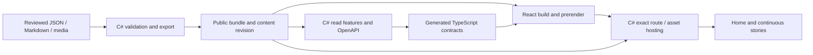

# Portfolio vertical slice architecture

Parent: [master plan](../../PortfolioStudioImplementation.md). Work items: [DeliveryPhases.md](DeliveryPhases.md). State: [Progress.md](Progress.md).

Implementation defaults and failure review: [ExecutionDecisions.md](ExecutionDecisions.md). Ordered packet checkpoints: [ImplementationCheckpoints.md](ImplementationCheckpoints.md). Figure specifications: [VisualProduction.md](VisualProduction.md).

## Owner decision and delivery rule

The owner prefers vertical slices of architecture. Organize application code around visitor use cases, and deliver each product slice through content, backend, frontend, hosting and acceptance together. The phase/packet IDs remain the task inventory; the slice table below groups them into visitor-visible outcomes. It does not create a second competing backlog.

P0–P3 are the necessary product import/identity/platform prerequisites. After them, implement one real story completely before expanding the catalog. Do not finish every backend endpoint, then every page, then postpone readable direct HTML to the last phase. A slice may need several cohesive PRs; intermediate plumbing is recorded as partial work until its full acceptance is verified.

## Delivery slices

| Slice | Visitor/operator outcome | Existing work packets | Exit evidence |
| --- | --- | --- | --- |
| VS0 — Independent product | Safe Portfolio checkout/image identity, React-only host and retained single-node operations | P0–P3; early P8 access/CI only when necessary | Own remotes/provenance, supported local gate/CI, no active Blazor/removed-target dependency |
| VS1 — Read ImprovedDb | Open home, choose ImprovedDb, read its full illustrated story and use section links in either theme | P4.1–P4.3, P5.1–P5.3, first-story P7.1/P7.3 and applicable P7.4 checks | One reviewed published story; consistent content/API/HTML revision; direct and fragment URLs; useful HTML without JavaScript; true missing/draft-route 404; keyboard/mobile/theme/image behavior; production image acceptance |
| VS2 — Add one reviewed story | Discover and read one additional complete project through the same experience | One P6 story packet at a time, followed by P6.12 catalog review | Reviewed contribution/status/prose/media; export/API/card/detail/prerender/sitemap/social output updated together; no public links to drafts; relevant slice checks and green merge/main evidence |
| VS3 — Match runtime to the product | Operate the final file-only portfolio | P7.2 | Unused DB/cache/Identity/migrations removed from startup/Compose/release/doctor/backup/audit/tests; verified production image without fake migration artifacts |
| VS4 — Visit the public portfolio | Read the reviewed launch set over public HTTPS on the intended hostname | P7.4, remaining P8, P9 | Immutable release and real native/LAN/Cloudflare/public/browser evidence; authorized deployment recorded |
| VS5 — Update and recover | Add content, release safely and recover using the supported commands | P10 and remaining independent P6 stories | Authoring handover, scoped restart/recovery and honest previous-release/rollback evidence; full catalog disposition |

ImprovedDb's P6.1 packet finishes its factual/media review within VS1 where required for publication; later editorial refinements remain small end-to-end updates. VS2 is repeatable, not a single batch containing all stories. The recommended initial launch set is ImprovedDb, KinoJoin, TraceBack and Unlost when reviewed. Late stories remain drafts and do not delay ready slices. Node bootstrap can move forward for CI capacity; it does not turn VS0 into a public deployment.

## Application boundaries

Use case boundaries own their request handling, mapping, failure states and checks. Reuse the template's feature registration conventions and generated contracts. Suggested destinations below must be reconciled with the selected baseline in P0; they are not files already implemented.

```text
Portfolio/
  Features/
    SiteContent/GetSite/             # home heading, public name and verified links
    ProjectCatalog/ListProjects/     # ordered lightweight published summaries
    ProjectStories/GetProject/       # one published story, sections and public assets
    PublicPages/ResolvePage/         # known prerender document/data and real 404 policy
  Content/                          # validated immutable bundle reader/export integration
Portfolio.Core/
  Features/Portfolio/Contracts/     # C# public DTOs used by OpenAPI
Portfolio.React/app/
  features/
    home/                           # home view, catalog query/loader adapter and states
    project-story/                  # detail query/loader, reader, section menu and states
  components/                       # only genuinely shared shell/theme/image primitives
  api/generated/                    # generated transport schema, never hand-edited
  routes/                           # thin Router route modules delegating to features
Portfolio.Test/
  Features/                         # backend/hosting checks grouped by use case
Content/Portfolio/                  # reviewed metadata, Markdown and media
```

Keep endpoint/handler/validation/mapping/checks next to their use case where the template supports that. A small handler can remain in one file; avoid adding empty abstractions to satisfy a folder diagram. A generic top-level Controllers/Services/Repositories hierarchy is not the organizing model for new portfolio behavior. Do not add a generic CRUD repository, CQRS bus or MediatR dependency without a concrete need. Published editorial content is an immutable file bundle, so a database repository is unnecessary for it.

`ProjectStories/GetProject` and the React reader serve every project by validated slug/metadata. Individual stories are content slices, not eleven copied backend modules or twelve special-case React pages. A new content block or interaction belongs to the story slice that first needs it; extract shared rendering after its behavior is defined.

Shared responsibilities stay narrow: immutable bundle loading/validation, generated transport/contracts, theme/shell primitives and generic deployment infrastructure. Implement `Portfolio.ContentTool` referencing shared C# contracts/compilation in `Portfolio.Core/Content`, using ExecutionDecisions' proposed CLI contract. It runs without DB/Redis/credentials and produces the same deterministic representation consumed by API and prerender. Shared code must not call feature modules to reconstruct a second content model. Sharp is a build-only raster preprocessor driven by the C# published-media plan.

## Cross-boundary contract



The arrows describe build/runtime boundaries, not API calls made during prerender. Prerender reads the exported snapshot offline. The deployed C# process serves known documents/navigation data/assets and same-origin API responses; production runs no Node server. API, HTML and media ship as one immutable release/revision.

Keep the master plan's public endpoints, lightweight collection, block union, stable section IDs, schema/revision, draft exclusion and Problem Details contracts. OpenAPI remains the API contract source; do not write duplicate DTOs in TypeScript. Router owns route matching/metadata/navigation; Query owns runtime API state when needed. Static snapshot data must not trigger a redundant API request on hydration.

## VS1 implementation sequence

Use successive reviewable PRs when necessary, retaining one active VS1 record:

1. Prepare real ImprovedDb source/prose/media and preserve the approved Studio references. Use the selected Markdig/safe-rendering contract; omit personal-role claims until verified rather than blocking neutral project copy.
2. Implement only the public authoring/export contract needed by this story and home. Other project metadata can remain drafts; do not build an all-purpose content framework first.
3. Implement the SiteContent, ProjectCatalog and ProjectStories read features with generated transport. Replace the corresponding Books consumer flows and remove former sample/account endpoints through the scoped P4.3 inventory.
4. Implement home, shared shell/theme and the ImprovedDb reader together with its content. Exercise existing loading/error/cancellation behavior where APIs are used.
5. Prerender home/ImprovedDb from that same bundle and implement exact C# direct-page/navigation-data/asset hosting. Add the first Portfolio public acceptance assertions in the image/local gate.
6. Complete the P5 visual checkpoint and applicable content/API/browser/hosting/image checks; verify the merged main release. Record the actual module paths, export/build commands, contract revision and precise next story.

VS1 finishes when a fresh production image supports the complete reading journey. API success alone, a mockup, an SPA shell or a renamed Books demo is partial work. Public DNS/native launch remains VS4.

## Slice handoff and review

For each slice, Progress records the visitor/operator outcome, owned packet IDs, affected content/backend/frontend/hosting/check files, dependencies, final contract/revision, PRs, exact-head/main CI and the next action. Store actual local commands after implementation. No reviewer must infer completion from separate backend/frontend status rows.

Review at the use-case boundary and across the actual journey: what reaches the API/export, what visitors read on direct requests/navigation, and what stays private/draft. If a layer genuinely has no change, record why. Keep unfinished public cards hidden. A content-only story update still rebuilds and checks its exported bundle, known routes and release; its applicable gate follows the actual downstream file types.
