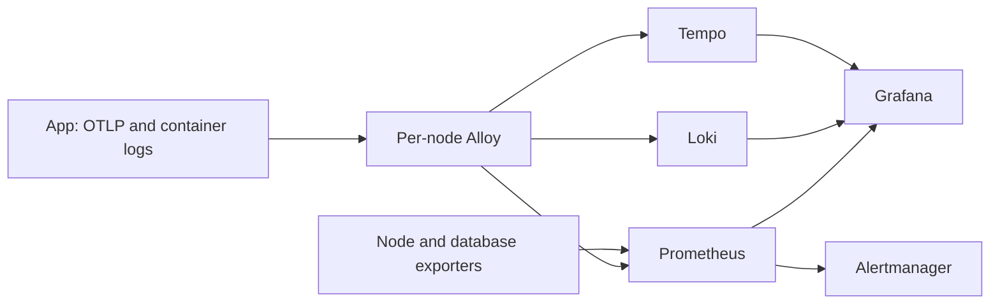

# Observability architecture

Use this guide when changing instrumentation or telemetry configuration. See [Operations](Operations.md) to access, query, validate, or recover the stack.

## Coverage and flow

Local Docker has an optional Compose profile. LocalCluster and Cloud place a private backend on an existing ingress node, with Alloy and node exporters on each node and database exporters on the data node. They do not add an observability node. LocalSingleNode leaves telemetry disabled.

The app exports metrics and traces to its local Alloy agent. Alloy reads container logs and forwards telemetry to the private backend. Prometheus scrapes node and database exporters, evaluates alert rules, and supplies metrics to Grafana. Loki stores logs; Tempo stores traces. Backend and collector endpoints stay on loopback or private node paths; they are never public app routes. Only intended app routes such as `/health/ready` are public, and that endpoint must reveal no secrets. App readiness does not depend on these services.

## Configuration ownership

| Concern | Source |
| --- | --- |
| App instrumentation and resource attributes | [`ObservabilityExtensions.cs`](../../GrumPlates/Infrastructure/Hosting/ObservabilityExtensions.cs) and [`appsettings.json`](../../GrumPlates/appsettings.json) |
| Local Compose services and resource limits | [`docker-compose.yml`](../../docker-compose.yml), [`Alloy config`](../../docker/observability/alloy/config.alloy), and the [local backend configs](../../docker/observability) |
| Shared dashboards, alert rules, routing, and runbooks | [Dashboard spec](../../Deployment/Common/observability/grafana/dashboard_spec.py), [Prometheus rules](../../Deployment/Common/observability/prometheus/rules), [Alertmanager config](../../Deployment/Common/observability/alertmanager/alertmanager.yml), and [runbooks](../../Deployment/Common/observability/runbooks) |
| LocalCluster retention and telemetry settings | [Group vars](../../Deployment/LocalCluster/inventory/prod/group_vars/all.yml), [backend role](../../Deployment/LocalCluster/ansible/roles/observability_backend/tasks/main.yml), and [agent role](../../Deployment/LocalCluster/ansible/roles/observability_agent/tasks/main.yml) |
| Cloud retention and telemetry settings | [Group vars](../../Deployment/Cloud/inventory/prod/group_vars/all.yml), [backend role](../../Deployment/Cloud/ansible/roles/observability_backend/tasks/main.yml), and [agent role](../../Deployment/Cloud/ansible/roles/observability_agent/tasks/main.yml) |

Common owns target-neutral dashboards, rules, runbooks, and checks. Each target owns its Compose or Ansible wiring, scrape targets, networks, firewall rules, retention values, and secrets. Keep LocalCluster and Cloud implementations separate. Store LocalCluster secrets in Ansible Vault and Cloud secrets in GitHub environment secrets; never put secrets, target host values, or telemetry data in Common or plaintext repository files.

## Correlation and bounded labels

The app sets `service.version`, `deployment.target`, and `host.name` resource attributes; dashboards expose them as `service_version`, `deployment_target`, and `host_name` to distinguish releases and instances. App logs include a `TraceId` field; use it to open the related Tempo trace. The app adds these attributes and log correlation in [`ObservabilityExtensions.cs`](../../GrumPlates/Infrastructure/Hosting/ObservabilityExtensions.cs).

Metric labels must stay bounded. Use stable dimensions such as target, environment, node, service, version, route, method, status, and operation. Never label by user or record IDs, email, full URL, query string, request or trace ID, IP address, user agent, or free-text exception. Loki labels identify the source; keep request and trace IDs as structured fields, not labels. Logs and trace attributes must not contain request bodies, credentials, cookies, tokens, connection strings, or raw user content. The shared [cardinality check](../../Deployment/Common/observability/scripts/check-telemetry-cardinality.sh) and [telemetry-cardinality runbook](../../Deployment/Common/observability/runbooks/telemetry-cardinality.md) cover the current guardrails.

## Sampling and failure behavior

Local `RunLocal.ps1 -Observability` uses a trace sampling ratio of `1.0`; deployed LocalCluster and Cloud settings currently use `0.1`. These values are target configuration, not application constants. Higher sampling increases storage, memory, and CPU; raise it only for a short investigation and restore the configured value afterward.

OpenTelemetry export is optional and must fail open for app startup and requests. The local app settings default it off. Caddy and cloudflared health is checked by target acceptance; their native metrics are not currently scraped.
